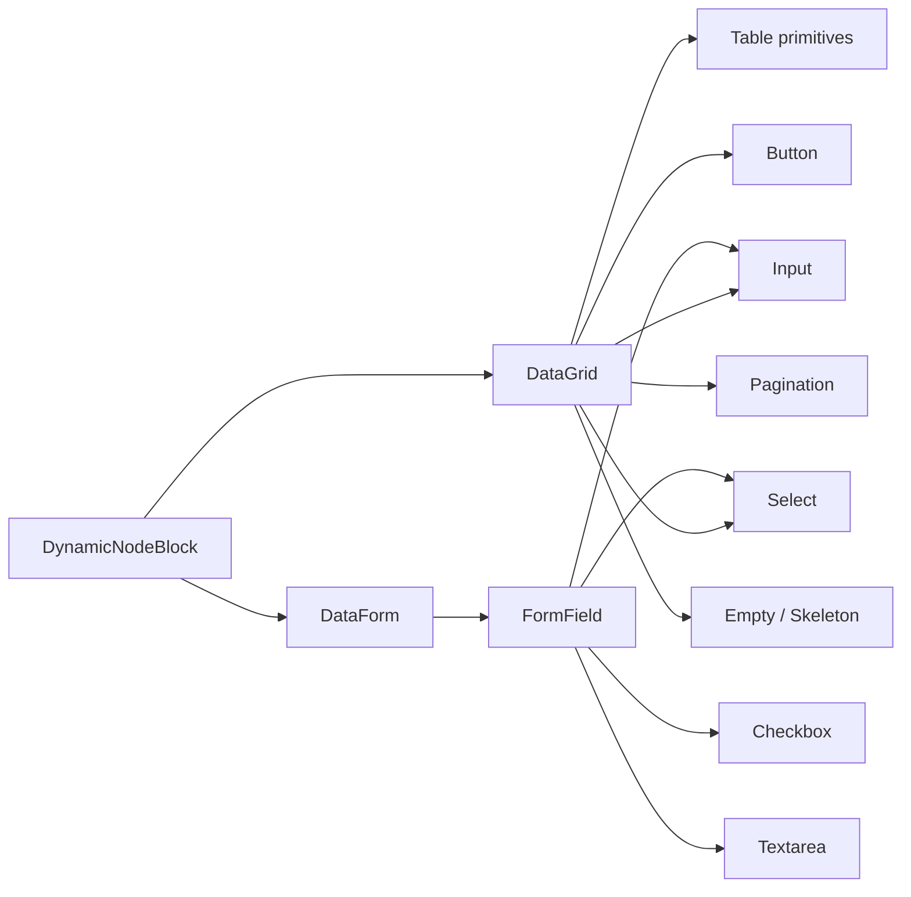

# DynamicBlock Component Composition Debt Handover

## Outcome

DynamicBlock must remain a descriptor-driven consumer of `LowlandTech.Components`. Its grid, forms, inputs, selects, buttons, pagination, empty states, and validation surfaces must be supplied by reusable library components rather than recreated with native HTML or DynamicBlock-specific Tailwind.

The visible problem in the DynamicBlock story is not primarily a DynamicBlock defect. `DynamicNodeBlock` already consumes `DataGrid`, `DataForm`, `Input`, `Button`, and other library components. The inconsistency appears because `DataGrid` and `DataForm` still render native controls internally.

Completion means:

- DynamicBlock contains no local replacement for shared grid, pager, or form controls.
- DataGrid's pager is composed from LowlandTech controls.
- DataForm and FormField use LowlandTech controls for supported field types.
- all behavior remains descriptor-driven and reusable outside DynamicBlock;
- component and DynamicBlock integration tests prove the composition contract;
- the standalone DynamicBlock story visually matches the component-library vocabulary.

## Current State

### DynamicBlock

`src/components/blocks/Session/DynamicNodeBlock.razor` correctly uses:

- `Input` for collection search;
- `Button` for creation and form actions;
- `DataGrid<object>` for descriptor-generated collections;
- `DataForm` for descriptor-generated entity forms;
- `Card`, `Badge`, `Progress`, `Alert`, `Avatar`, `Icon`, and `Separator` for presentation.

Do not replace these with local markup.

### DataGrid leak

`src/components/lib/DataGrid/DataGrid.razor` currently implements much of its internal structure with native elements:

- `<table>`, `<thead>`, `<tbody>`, `<tr>`, `<th>`, and `<td>`;
- filter `<input>`;
- sort, expansion, previous, and next `<button>` elements;
- pager page-size `<select>` and `<option>` elements;
- hand-authored loading and empty text.

The immediate screenshot mismatch comes from the page-size `<select>` and pager buttons. The DataGrid specification already says the grid should reuse `Table`, `Button`, `Checkbox`, `Input`, `Select`, `Pagination`, `Empty`, `Skeleton`, and related components.

### DataForm leak

`src/components/lib/DataForm/DataForm.razor` and `FormField.razor` use `Checkbox` and `Select` for boolean and enum values, but still use native:

- text inputs;
- numeric inputs;
- date and date-time inputs;
- textareas;
- node-reference and GUID inputs.

These native controls reproduce styling, invalid-state, disabled-state, attribute-forwarding, and event behavior that should be owned by the component library.

### Worktree warning

At handover creation time, the shared `develop` checkout contains uncommitted edits to DynamicBlock, DataGrid, stories, tests, and generated CSS. In particular, the in-progress DataGrid edit adds `AlwaysShowPager`, `PageSizeOptions`, `PageSizeChanged`, and a native page-size `<select>`.

Before implementation:

1. inspect `git status` and `git diff`;
2. identify the owner of the existing edits;
3. preserve or finish that behavior;
4. replace the native pager markup without discarding the new paging API.

Do not reset, stash, overwrite, or silently absorb another agent's changes.

## Architecture Decision

The repair belongs in the shared components, not in DynamicBlock.



Page-specific Tailwind remains acceptable for composition and spacing. It must not duplicate reusable control behavior or visual states.

## Implementation Plan

### Phase 1: lock the composition contract with tests

Add failing bUnit tests before changing markup.

#### DataGrid tests

Extend `src/components/test/SPEC1062.DataGrid/` to prove:

- page-size selection renders a LowlandTech `Select`, not an unwrapped native select;
- previous and next actions render `Button` or `Pagination` primitives;
- filter editors render `Input`;
- multi-selection continues to render `Checkbox`;
- empty and loading defaults use `Empty` and `Skeleton` or `Spinner`;
- page-size changes reset the page index and invoke both controlled callbacks;
- controlled page size and page index rehydrate after rerender;
- existing sorting, filtering, selection, keyboard, and serialization behavior remains intact.

Tests should assert component instances where practical and stable `data-slot` contracts where DOM assertions are required. Do not assert incidental Tailwind class strings.

#### DataForm tests

Extend `src/components/test/SPEC1072.DataForm/` to prove:

- string, GUID, node-reference, numeric, date, and date-time fields use library controls;
- enum fields use `Select`;
- booleans use `Checkbox`;
- multiline/JSON fields use `Textarea`;
- disabled, read-only, required, invalid, and described-by attributes reach the rendered control;
- value-changing and value-changed callbacks retain their current semantics;
- validation messages and store integration still work;
- persisted/controlled values rehydrate after rerender.

#### DynamicBlock integration tests

Extend `src/components/test/SPEC1078.Session/US04.DynamicBlock/` to prove:

- collection mode contains `DataGrid`, `Input`, and `Button`;
- the always-visible pager uses the shared select and navigation controls;
- descriptor-generated forms render shared controls for representative string, boolean, enum, number, and date fields;
- creating an item updates the grid without introducing a local grid implementation;
- editing and saving still dispatch the expected DynamicBlock mutation;
- standalone story rendering contains no unwrapped pager select.

Every new or touched test requires `Fact`, `Trait(Spec.UAC, ...)`, `Given`, `When`, and `Then`.

### Phase 2: refactor the DataGrid pager

Keep the in-progress public API unless tests establish a necessary adjustment:

- `AlwaysShowPager`;
- `PageSize`;
- `PageSizeOptions`;
- `PageSizeChanged`;
- `PageIndex`;
- `PageIndexChanged`.

Replace the native page-size selector with `Select`, `SelectTrigger`, `SelectValue`, `SelectContent`, and `SelectItem`.

Replace native previous/next buttons with either:

1. the existing `Pagination` family if it supports the required controlled callbacks and disabled states; or
2. `Button` components inside the DataGrid pager until Pagination is capable enough.

Prefer option 1 only when it does not weaken keyboard behavior, callback semantics, or accessibility. Do not expand this ticket into a complete Pagination rewrite.

Requirements:

- page-size values remain strings only at the Select boundary and are converted once;
- changing page size resets `PageIndex` to zero;
- callbacks fire exactly once per user action;
- disabled states are owned by the component parameters;
- labels and aria text are localizable;
- existing `data-slot="data-grid-*"` hooks remain stable;
- pager state remains serializable through `DataGridStateRepresentation`.

### Phase 3: refactor DataGrid internal controls

Replace reusable native controls in this order:

1. filter input → `Input`;
2. sort action → `Button` with an unstyled/ghost variant as appropriate;
3. detail expansion action → `Button`;
4. loading default → `Skeleton` or `Spinner`;
5. empty default → `Empty`;
6. table structure → evaluate and compose the existing `Table` family where its cascading/generic contract is compatible.

The semantic table elements may remain inside the `Table` implementation. The objective is not to eliminate HTML; it is to centralize reusable behavior and styling.

If the existing Table API cannot support DataGrid's generic column registration, row templates, hierarchy, keyboard navigation, or dynamic colspans, document the incompatibility and add the smallest reusable Table extension. Do not force DataGrid through an API that loses behavior.

### Phase 4: refactor DataForm and FormField

Create one internal mapping from field metadata to a library editor. Avoid maintaining separate, drifting editor switches in both `DataForm.razor` and `FormField.razor`.

Target mapping:

| Field kind | Component |
|---|---|
| text, GUID, node reference | `Input` |
| integer, decimal | `Input Type="number"` |
| date | `Input Type="date"` |
| date-time | `Input Type="datetime-local"` |
| boolean | `Checkbox` |
| enum | `Select` family |
| multiline/JSON | `Textarea` |
| unsupported/custom | caller-provided `FieldTemplate` |

The shared editor path must preserve:

- reflection and descriptor-based value conversion;
- nullable values;
- enum conversion;
- `ReadOnly` and `Disabled`;
- validation state and messages;
- `aria-invalid` and `aria-describedby`;
- field lifecycle callbacks;
- DataForm store dispatch;
- outbox-compatible controlled state and reload hydration;
- arbitrary attributes supported by the target component.

Do not add DynamicBlock type checks to DataForm. It must remain reusable for any model.

### Phase 5: keep DynamicBlock thin

After the shared refactors, change DynamicBlock only where integration requires it:

- pass controlled pager values and callbacks;
- pass descriptor field metadata needed by DataForm;
- retain dynamic column generation through `DataGridColumn<object>`;
- retain mutation dispatch through `IDynamicBlockDispatcher`;
- retain presentation-only composition around the shared form and grid.

Do not add:

- native `<table>`, `<select>`, `<input>`, or pager buttons;
- DynamicBlock-only copies of DataGrid or DataForm styling;
- field-type switches that duplicate DataForm;
- component-library CSS inside DynamicBlock;
- reflection-based editors in `DynamicNodeBlock`.

### Phase 6: stories and visual verification

Update or add Showcode stories for:

- DataGrid pager with one page and `AlwaysShowPager`;
- DataGrid pager with multiple pages;
- page-size changes;
- DataForm containing every supported editor kind;
- DynamicBlock collection and detail forms.

Verify the standalone DynamicBlock story at the URL used by the component app. Capture desktop and narrow-width screenshots. Confirm:

- the page-size control matches other LowlandTech selects;
- buttons match library size, radius, focus, disabled, and hover states;
- pager alignment does not jump between one and multiple pages;
- form controls have consistent height and invalid/read-only states;
- keyboard focus is visible;
- dark theme remains correct.

## Localization

The following text must not remain hardcoded inside DataGrid or DataForm:

- Rows;
- Previous;
- Next;
- Page X of Y;
- Loading;
- No results found;
- Select;
- Submit;
- Reset;
- field placeholders and accessible labels.

Use the repository's RESX/localizer convention for the owning component project, including every supported culture. Tests must verify embedded resource catalog parity.

## CSS and Styling

CSS should describe component slots, not DynamicBlock-specific descendants.

Expected ownership:

- `cn-data-grid-*` styles stay with DataGrid;
- Input, Select, Button, Pagination, Empty, Skeleton, and Textarea own their control visuals;
- DynamicNodeBlock owns only layout composition such as spacing and presentation wrappers.

After changing Tailwind sources:

1. rebuild component CSS;
2. rebuild shell/web CSS only if their generated outputs consume the changed sources;
3. include generated CSS files required by the repository;
4. verify that generated changes are intentional and not formatting churn.

## Verification Commands

Run focused tests first:

```powershell
dotnet test src/components/test/LowlandTech.Components.Tests.csproj --filter "FullyQualifiedName~SPEC1062.DataGrid"
dotnet test src/components/test/LowlandTech.Components.Tests.csproj --filter "FullyQualifiedName~SPEC1072.DataForm"
dotnet test src/components/test/LowlandTech.Components.Tests.csproj --filter "FullyQualifiedName~US04.DynamicBlock"
```

Then run:

```powershell
dotnet test src/components/test/LowlandTech.Components.Tests.csproj
dotnet build foundry.slnx
```

Run the component story application and visually inspect the DynamicBlock and component stories. Playwright coverage is required for frontend behavior that cannot be adequately proven by bUnit.

## Acceptance Criteria

- [x] DataGrid pager contains no unwrapped native `<select>`.
- [x] DataGrid pager actions use LowlandTech Button or Pagination components.
- [x] DataGrid filters use LowlandTech Input.
- [x] DataGrid defaults use shared empty/loading components.
- [x] DataForm/FormField use shared controls for every supported field kind.
- [x] No editor switch is duplicated across DataForm and FormField.
- [x] DynamicNodeBlock remains a consumer and contains no local control implementation.
- [x] Pager callbacks, page reset, serialization, and hydration are tested.
- [x] Form conversion, validation, controlled values, and hydration are tested.
- [x] DynamicBlock create/edit behavior remains tested.
- [x] All touched tests have complete BDD traceability attributes.
- [x] User-visible strings are localized in all supported cultures.
- [x] Standalone stories demonstrate the repaired composition.
- [ ] Dark theme, keyboard focus, disabled, invalid, and narrow-width states are visually verified.
- [x] Existing uncommitted DynamicBlock/DataGrid work is preserved or intentionally integrated (working tree was clean at handover; no in-flight edits were present).
- [x] Component tests and solution build pass.

### Remaining work

- **Visual verification**: Run the component story app and inspect DataGrid/DataForm/DynamicBlock stories across light/dark themes, narrow widths, disabled/invalid/focus states. Capture screenshots and add Playwright coverage where bUnit cannot prove behavior.

## Out of Scope

- redesigning DynamicBlock's descriptor or mutation architecture;
- replacing DataGrid with a third-party grid;
- completing every P1/P2 feature in the DataGrid roadmap;
- adding DynamicBlock-specific component variants;
- broad visual redesign of the SessionBlock shell;
- unrelated cleanup in plugin pages.

## Recommended Delivery Sequence

Use separate semantic commits so regressions are easy to isolate:

1. `test(components): define shared control composition contracts`
2. `refactor(datagrid): compose pager and filters from library controls`
3. `refactor(dataform): centralize descriptor editor composition`
4. `test(session): prove DynamicBlock shared component integration`
5. `docs(components): close DynamicBlock composition debt handover`

Each commit must reference the assigned issue number. The final ticket should not close until the visual story verification and focused tests are complete.

---

## Navigation

[[components/_index|Back to Index]]
